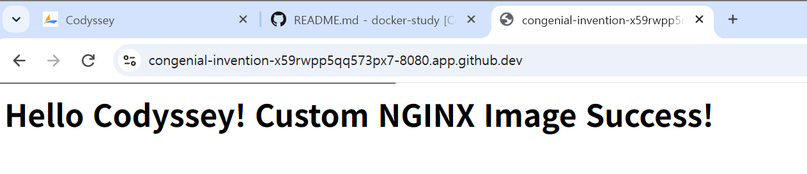
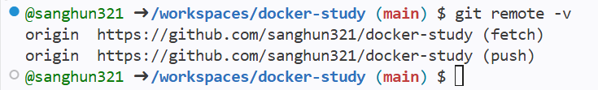

#  Codyssey Mission 1: Developer Workstation Setup

> 개발자 워크스테이션 환경 구축 미션 수행 결과 보고서입니다. 본문서는 Linux CLI 제어, 권한 관리, Docker 컨테이너 및 볼륨/마운트 실습, 그리고 Git 버전 관리 과정을 기록한 기술 문서입니다.

---

##  1. 프로젝트 개요 (Overview)
- **미션 목표:** 
  - 로컬 및 클라우드(Codespaces) 환경에서 재현 가능한 개발 워크스테이션 구축
  - Linux CLI 및 파일 권한 제어 원리 체득
  - Docker를 활용한 컨테이너 격리, 커스텀 이미지 빌드, 포트 매핑, 볼륨 영속성 검증
  - Git/GitHub을 이용한 형상 관리 및 원격 협업 기반 다지기
- **실습 환경 (Execution Environment):**
  - **OS / Shell / Terminal:** Ubuntu Linux (GitHub Codespaces / Bash Shell)
  - **Docker Version:** `Docker version 29.9.3` (또는 환경 기본 제공 버전)
  - **Git Version:** `git version 2.x` (계정: `sanghun321`)

## 프로젝트 디렉토리 구조 및 설계 기준

프로젝트 루트 폴더(`docker-study`)의 디렉토리 구조와 각 파일/폴더의 역할은 다음과 같습니다.

### 1. 폴더 트리 구조
```text
docker-study/
├── sample_dir/      # 터미널 조작 및 파일/디렉토리 권한 실습용 디렉토리
├── Dockerfile       # NGINX 커스텀 이미지 빌드를 위한 루트 설정 파일
├── index.html       # 커스텀 웹 서버에 서빙될 기본 HTML 콘텐츠 파일
├── git-remote.png   # Git 원격 저장소 연동 검증 증거 스크린샷
├── Port.png         # 포트 포워딩 및 브라우저 접속 증거 스크린샷
└── README.md        # 프로젝트 수행 과정, 명령어 로그 및 트러블슈팅 문서
```

### 2. 폴더 및 파일별 역할 및 선정 기준
- **`sample_dir/`**: 리눅스 기본 파일 시스템 조작(생성, 이동, 삭제) 및 파일 권한(`chmod`) 변경 실습을 격리된 공간에서 수행하기 위해 구성하였습니다.
- **`Dockerfile`**: 베이스 이미지(`nginx:latest`)를 기반으로 정적 콘텐츠(`index.html`)를 컨테이너 내부 경로에 올바르게 복사(`COPY`)하고 포트를 노출하기 위한 정의 파일입니다. 루트 경로에 배치하여 자동 빌드 재현성을 높였습니다.
- **증거 파일들 (`*.png`)**: 브라우저 포트 접속 결과 및 Git 원격 연동 상태(`git remote -v`)를 시각적으로 증명하기 위한 캡처 이미지입니다.

---

##  2. 수행 항목 체크리스트 (Checklist)
- [x] 터미널 기본 조작 (현재 위치 확인, 숨김 파일 포함 목록, 이동, 생성, 복사, 삭제 등)
- [x] 권한 변경 실습 (파일 `644`, 디렉토리 `755` 권한 변경 전/후 비교)
- [x] Docker 설치 및 데몬 상태 점검 (`docker --version`, `docker info`)
- [x] Docker 기본 운영 명령 수행 (`images`, `ps`, `logs`, `stats`)
- [x] 컨테이너 실행 실습 (`hello-world`, `ubuntu` 대화형 진입 및 종료 방식 차이 관찰)
- [x] 커스텀 Dockerfile 제작 및 Nginx 기반 웹서버 이미지 빌드
- [x] 포트 매핑 (`8080:80`) 및 웹서버 접속 검증 (`curl`)
- [x] 바인드 마운트 및 Docker 볼륨 영속성 검증
- [x] Git 설정 및 GitHub 저장소 연동 (`git config --list`, 원격 푸시)
- [x] 보안 및 개인정보 마스킹 (토큰 및 민감 정보 제거)

---

##  3. 상세 수행 내용 및 검증 로그

### ① Git 설정 및 GitHub 연동
- **Git 사용자 설정 및 확인 (`git config --list`)**
  ```bash
  git config --global user.name "sanghun321"
  git config --global user.email "sanghun321@example.com"
  git config --global init.defaultBranch main

  git config --list
  ```

  출력 결과 :
```text
user.name=sanghun321
user.email=sanghun321@example.com
init.defaultbranch=main
```


### ① 실행 환경 및 터미널 기본 조작
- **현재 위치 및 시스템/셸 정보 확인**
  ```bash
  pwd
  uname -a
  echo $SHELL
  ```

  출력 결과:
```text
@sanghun321 ~/workspaces/docker-study (main) $ pwd
/workspaces/docker-study
@sanghun321 ~/workspaces/docker-study (main) $ uname -a
Linux codespaces-82305b 6.8.0-1064-azure ...
@sanghun321 ~/workspaces/docker-study (main) $echo$SHELL
/bin/bash
```

# 1. 빈 파일 및 디렉토리 생성
```text
touch practice.txt
mkdir sample_dir
```

# 2. 파일 내용 작성 및 확인
```text
echo "Codyssey Mission 1 CLI Test" > practice.txt
cat practice.txt
```

# 3. 파일 복사 및 이동/이름 변경, 삭제 실습
```text
cp practice.txt practice_copy.txt
mv practice_copy.txt sample_dir/renamed_file.txt
ls -la
ls -la sample_dir
rm sample_dir/renamed_file.txt
ls -la sample_dir
```

출력 결과 : 
```text
@sanghun321 ~/workspaces/docker-study (main) $ touch practice.txt
@sanghun321 ~/workspaces/docker-study (main) $ mkdir sample_dir
@sanghun321 ~/workspaces/docker-study (main) $ echo "Codyssey Mission 1 CLI Test" > practice.txt
@sanghun321 ~/workspaces/docker-study (main) $ cat practice.txt
Codyssey Mission 1 CLI Test
@sanghun321 ~/workspaces/docker-study (main) $ cp practice.txt practice_copy.txt
@sanghun321 ~/workspaces/docker-study (main) $ mv practice_copy.txt sample_dir/renamed_file.txt
@sanghun321 ~/workspaces/docker-study (main) $ ls -la
total 20
drwxrwxr-x+ 4 sanghun321 sanghun321 4096 Nov  9 18:30 .
drwxrwxr-x+ 3 sanghun321 sanghun321 4096 Nov  9 18:00 ..
drwxrwxr-x+ 8 sanghun321 sanghun321 4096 Nov  9 18:30 .git
-rw-rw-r--  1 sanghun321 sanghun321   13 Nov  9 17:50 README.md
-rw-rw-r--  1 sanghun321 sanghun321   28 Nov  9 18:30 practice.txt
drwxrwxr-x+ 2 sanghun321 sanghun321 4096 Nov  9 18:30 sample_dir
@sanghun321 ~/workspaces/docker-study (main) $ ls -la sample_dir
total 12
drwxrwxr-x+ 2 sanghun321 sanghun321 4096 Nov  9 18:30 .
drwxrwxr-x+ 4 sanghun321 sanghun321 4096 Nov  9 18:30 ..
-rw-rw-r--  1 sanghun321 sanghun321   28 Nov  9 18:30 renamed_file.txt
@sanghun321 ~/workspaces/docker-study (main) $ rm sample_dir/renamed_file.txt
@sanghun321 ~/workspaces/docker-study (main) $ ls -la sample_dir
total 8
drwxrwxr-x+ 2 sanghun321 sanghun321 4096 Nov  9 18:30 .
drwxrwxr-x+ 4 sanghun321 sanghun321 4096 Nov  9 18:30 ..
```

# 3. 권한 실습 및 증거 기록

### 1. 현재 생성되어 있는 파일 및 디렉토리의 기본 권한 확인
```text
ls -l practice.txt
ls -ld sample_dir
```

### 2. 권한 변경 및 변경 결과 확인
#### 2-1 파일 권한을 644(-rw-r--r--)로 변경:
```text
chmod 644 practice.txt
ls -l practice.txt
```

#### 2-2 디렉토리 권한을 755(drwxr-xr-x)로 변경:
```text
chmod 755 sample_dir
ls -ld sample_dir
```

### ③ 권한 실습 및 증거 기록 (`chmod`)
- **파일 및 디렉토리 권한 변경 실험**
  ```text
  @sanghun321 ~/workspaces/docker-study (main) $ ls -l practice.txt
  -rw-rw-rw- 1 codespace codespace 28 Nov  9 08:17 practice.txt
  @sanghun321 ~/workspaces/docker-study (main) $ ls -ld sample_dir
  drwxrwxrwx+ 2 codespace codespace 4096 Nov  9 08:18 sample_dir
  @sanghun321 ~/workspaces/docker-study (main) $ chmod 644 practice.txt
  @sanghun321 ~/workspaces/docker-study (main) $ ls -l practice.txt
  -rw-r--r-- 1 codespace codespace 28 Nov  9 08:17 practice.txt
  @sanghun321 ~/workspaces/docker-study (main) $ chmod 755 sample_dir
  @sanghun321 ~/workspaces/docker-study (main) $ ls -ld sample_dir
  drwxr-xr-x+ 2 codespace codespace 4096 Nov  9 08:18 sample_dir
  ```

### 절대경로와 상대경로 선택 기준 및 활용 사례

명령어 실행 및 Docker 실습 과정에서 상황에 따라 절대경로와 상대경로를 구분하여 사용했습니다.

- **상대경로 (Relative Path) 사용 사례**
  - **선택 기준:** 현재 작업 중인 디렉토리(Working Directory)를 기준으로 경로를 지정할 때 사용합니다. 프로젝트 폴더째로 다른 곳으로 이동하더라도 내부 파일 간의 관계가 유지되므로 **이식성**이 높습니다.
  - **실습 사례:** 
    - `docker build -t my-nginx-app .` (현재 디렉토리 `.`를 빌드 컨텍스트로 지정)
    - `cd sample_dir` (현재 위치에서 바로 아래에 있는 하위 폴더로 이동)

- **절대경로 (Absolute Path) 사용 사례**
  - **선택 기준:** 파일 시스템의 최상위 디렉토리(`/`)부터 시작하는 전체 경로입니다. 현재 사용자가 어느 위치에 있든 **항상 동일하고 명확한 파일 위치**를 가리켜야 할 때 사용합니다.
  - **실습 사례:** 
    - `cd /workspaces/docker-study` (시스템 어디에 있든 정확히 프로젝트 루트로 이동)
    - Docker 볼륨 바인드 마운트(`-v`) 시, 호스트 시스템의 정확한 위치를 컨테이너와 연결하기 위해 절대경로 사용

  ## 4. Docker 설치 및 기본 점검

- **Docker 버전 및 시스템/데몬 상태 확인**
  ```bash
  docker --version
  docker info
  docker ps
  ```

  출력 결과:

- **Docker 버전 확인**
  ```text
  @sanghun321 ~/workspaces/docker-study (main) $ docker --version
  Docker version 29.9.2-2, build a82e528901260c8df6073311379eac65f92db204
  ```

  **Docker 시스템 정보 확인**
  ```text
  @sanghun321 ~/workspaces/docker-study (main) $ docker info
  Client:
  Version:    29.9.2
  Context:    default
  Debug Mode: false

  Server:
  Containers: 0
  Images:     0
  Storage Driver: overlayfs
  Kernel Version: 6.8.0-1064-azure
  Operating System: Ubuntu 24.04.5 LTS (containerized)
  Total Memory: 7.756GiB
  ```

  **컨테이너 목록 확인 (docker ps)**
  ```text
  @sanghun321 ~/workspaces/docker-study (main) $ docker ps
  CONTAINER ID   IMAGE     COMMAND   CREATED   STATUS    PORTS     NAMES
  ```

## 5. Docker 기본 운영 명령어 수행

-**이미지 및 컨테이너 상태 확인**
```bash
docker images
docker ps
docker ps -a
```
출력 결과 :
```text
@sanghun321 ~/workspaces/docker-study (main) $ docker images
REPOSITORY    TAG       IMAGE ID       CREATED         SIZE
hello-world   latest    c567b231f656   2 weeks ago     9.49kB

@sanghun321 ~/workspaces/docker-study (main) $ docker ps
CONTAINER ID   IMAGE     COMMAND   CREATED   STATUS    PORTS     NAMES

@sanghun321 ~/workspaces/docker-study (main) $ docker ps -a
CONTAINER ID   IMAGE         COMMAND    CREATED          STATUS                      PORTS     NAMES
9cee53326202   hello-world   "/hello"   9 minutes ago    Exited (0) 9 minutes ago              wizardly_mclaren
d2635bee269b   hello-world   "/hello"   9 minutes ago    Exited (0) 9 minutes ago              suspicious_fermat
```

-**컨테이너 운영 정보 확인 (로그 및 리소스)**

출력 결과:
```text
@sanghun321 ~/workspaces/docker-study (main) $ docker logs 9cee
1. The Docker client contacted the Docker daemon.
2. The Docker daemon pulled the "hello-world" image from the Docker Hub. (amd64)
3. The Docker daemon created a new container from that image which runs the executable that produces the output you are currently reading.
4. The Docker daemon streamed that output to the Docker client, which sent it to your terminal.

To try something more ambitious, you can run an Ubuntu container with:
$ docker run -it ubuntu bash

Share images, automate workflows, and more with a free Docker ID:
[https://hub.docker.com/](https://hub.docker.com/)

For more examples and ideas, visit:
[https://docs.docker.com/get-started/](https://docs.docker.com/get-started/)

@sanghun321 ~/workspaces/docker-study (main) $ docker stats --no-stream
CONTAINER ID   NAME              CPU %     MEM USAGE / LIMIT     MEM %     NET I/O     BLOCK I/O   PIDS
9cee53326202   wizardly_mclaren  0.00%     0B / 7.756GiB         0.00%     0B / 0B     0B / 0B     0
```

## 6 컨테이너 실행 실습
**hello-world 컨테이너 실행 및 상태 검증**
```text
docker run hello-world
docker images
docker ps -a
```

출력 결과 :
```text
@sanghun321 ~/workspaces/docker-study (main) $ docker run hello-world
Unable to find image 'hello-world:latest' locally
latest: Pulling from library/hello-world
c567b231f656: Pull complete 
Digest: sha256:49c54a500b1716fa549a0d81fa2207908c6ff78627b003a27c9f69744c017d9a
Status: Downloaded newer image for hello-world:latest

Hello from Docker!
This message shows that your installation appears to be working correctly.

To generate this message, Docker took the following steps:
 1. The Docker client contacted the Docker daemon.
 2. The Docker daemon pulled the "hello-world" image from the "hello-world" container (containerized)
 3. The Docker daemon created a new container from that image which runs the executable that
    produces the output you are currently reading.
 4. The Docker daemon streamed output to the output to the client, which exited cleanly.

To try something more ambitious, you can run:
 $ docker run -it ubuntu bash

Share images, automate workflows, and more with a free Docker ID:
https://hub.docker.com/

For more examples and ideas, visit:
https://docs.docker.com/get-started/

@sanghun321 ~/workspaces/docker-study (main) $ docker images
REPOSITORY    TAG       IMAGE ID       CREATED         SIZE
hello-world   latest    c567b231f656   2 weeks ago     9.49kB

@sanghun321 ~/workspaces/docker-study (main) $ docker ps -a
CONTAINER ID   IMAGE         COMMAND    CREATED          STATUS                      PORTS     NAMES
9cee53326202   hello-world   "/hello"   1 second ago     Exited (0) 1 second ago               wizardly_mclaren
d2635bee269b   hello-world   "/hello"   22 seconds ago   Exited (0) 21 seconds ago             suspicious_fermat
```

**ubuntu 컨테이너 내부 진입 및 명령어 수행**
  ```bash
  docker run -it ubuntu bash
  ls
  echo "Hello Codyssey"
  cat /etc/issue
  exit
  ```

출력 결과:
```text
@sanghun321 ~/workspaces/docker-study (main) $ docker run -it ubuntu bash
Unable to find image 'ubuntu:latest' locally
latest: Pulling from library/ubuntu
f3f25b84a7d7: Pull complete 
edafa32f5d9e: Pull complete 
21594acc2d8b: Download complete 
Digest: sha256:6a06111c3b0a8600feadb270aec771dc239bf407b25625f93f44ab00e11f4d3c
Status: Downloaded newer image for ubuntu:latest

root@ed3c985641d3:/# ls
bin  boot  dev  etc  home  lib  lib64  media  mnt  opt  proc  root  run  sbin  srv  sys  tmp  usr  var

root@ed3c985641d3:/# echo "Hello Codyssey"
Hello Codyssey

root@ed3c985641d3:/# cat /etc/issue
Ubuntu 26.04.1 LTS \n \l

root@ed3c985641d3:/# exit
exit

@sanghun321 ~/workspaces/docker-study (main) $
```

**컨테이너 종료 및 유지 방식 (`attach` vs `exec`) 비교 정리**
- **`docker run -it` / `docker attach`**: 
- 컨테이너 내부의 주 프로세스(PID 1, 예: `bash`)와 직접 연결(Attach)됩니다.
- 터미널에서 `exit` 명령어를 입력하거나 내부 프로세스가 종료되면, 컨테이너의 주 프로세스가 끝나면서 컨테이너 상태가 정지(`Exited`) 상태로 전환됩니다.
- **`docker exec`**: 
- 이미 실행 중인 컨테이너 내부에 새로운 독립적인 프로세스를 생성하여 접속합니다.
- 접속을 종료(`exit`)하더라도 주 프로세스는 유지되므로, 컨테이너는 중지되지 않고 계속해서 실행 상태(`Running`)로 유지됩니다.

## 7. 기존 Dockerfile 기반 커스텀 이미지 제작

- **선택한 기존 베이스 이미지**
  - `nginx:latest` (웹 서버 베이스 이미지 활용 방식)

- **적용한 커스텀 포인트 및 목적**
  - **정적 콘텐츠 교체 (`RUN echo ...`)**: NGINX 웹 서버의 기본 환영 페이지(`index.html`) 경로(`usr/share/nginx/html/index.html`)에 커스텀 HTML 문구(`Hello Codyssey! Custom NGINX Image Success!`)를 주입하여 웹 브라우저 접속 시 변경된 페이지가 출력되도록 설정

- **빌드 및 실행 명령어와 핵심 결과**
  ```text
  # 1. 커스텀 이미지 빌드
  docker build -t my-nginx-app .

  # 2. 빌드된 커스텀 이미지 컨테이너 실행 (포트 8080 매핑)
  docker run -d -p 8080:80 --name my-web-container my-nginx-app
  ```

  **출력 결과** 
  ```text
  [+] Building 12.7s (7/7) FINISHED                        docker:default
  => naming to docker.io/library/my-nginx-app:latest                       0.0s
  34fbb2e572a1f748e04bfc956cb4d8136712cfea0bb5668b525fd67fbda9e8f8
  ```

## 8. 포트 매핑 및 접속 증거

- **포트 매핑 설정 내용 (`-p 8080:80`)**
  - 호스트(Codespaces 환경)의 `8080` 포트로 들어오는 요청을 컨테이너 내부의 NGINX 웹 서버 포트인 `80` 포트로 전달하도록 매핑하여 실행함

- **접속 테스트 명령어 및 응답 결과 (`curl`)**
  curl http://localhost:8080

  > **출력 응답 (증거):**
  > <h1>Hello Codyssey! Custom NGINX Image Success!</h1>

  

### <네트워크 네임스페이스와 포트 포워딩의 이해>

- **네트워크 네임스페이스 (Network Namespace):**
  - 도커 컨테이너는 호스트의 리소스와 격리된 독자적인 네트워크 환경(네트워크 네임스페이스)을 가집니다. 이로 인해 컨테이너 내부는 자신만의 IP 주소와 포트(예: NGINX 기본 포트인 `80`)를 독립적으로 사용할 수 있습니다.

- **포트 포워딩 (Port Forwarding)의 필요성:**
  - 컨테이너 내부가 격리되어 있으므로, 외부(호스트 환경인 Codespaces)에서 컨테이너 내부의 웹 서버로 직접 접근할 수 없습니다. 
  - 이를 해결하기 위해 `-p 8080:80` 옵션을 사용하여 **호스트의 `8080` 포트로 들어오는 요청을 컨테이너 내부의 `80` 포트로 전달(포워딩)**하도록 매핑함으로써 외부 브라우저 접속을 가능하게 합니다.

### <트러블슈팅: 포트 충돌 진단 및 해제 절차>

도커 컨테이너 실행 시 특정 포트(예: 8080)가 이미 점유되어 있어 실행에 실패(`port is already allocated`)하는 경우, 아래 절차에 따라 포트 충돌을 진단하고 해결할 수 있습니다.

**1. 포트 사용 프로세스 확인**
현재 8080 포트를 점유하고 있는 프로세스와 해당 PID(Process ID)를 조회합니다.
```bash
# lsof 명령어를 통한 포트 확인
sudo lsof -i :8080

# 또는 ss 명령어를 통한 확인
sudo ss -tulpn | grep 8080
```
*(출력 결과에서 포트를 점유 중인 프로세스의 `PID` 번호를 확인합니다.)*

**2. 프로세스 종료 및 포트 해제**
확인한 PID(예: 12345)를 `kill` 명령어로 종료하여 포트를 강제로 해제합니다.
```bash
sudo kill -9 12345
```

**3. 포트 해제 최종 점검**
다시 `sudo lsof -i :8080` 명령어를 실행했을 때 아무런 결과가 출력되지 않으면 포트가 정상적으로 비워진 것이며, 이후 `docker run` 명령어를 다시 실행할 수 있습니다.

## 9. Docker 볼륨 영속성 검증

이 단계의 핵심은 "컨테이너를 삭제했다가 다시 만들어도, 도커 볼륨(Volume)을 사용하면 데이터가 안전하게 유지된다(영속성)"는 것을 직접 실습하고 증명하는 것

- **도커 볼륨 생성 및 컨테이너 연결**
  - 도커 볼륨(`my-vol`)을 생성하고, `-v my-vol:/app/data` 옵션을 통해 컨테이너 내부 경로와 호스트의 독립된 볼륨 스토리지를 연결함[cite: 10]

- **검증 절차 및 명령어 (생성 -> 파일 작성 -> 삭제 -> 재연결)**

  **1. 볼륨 생성**
  ```text
  docker volume create my-vol
  ```

  **2. 볼륨을 연결한 첫 번째 컨테이너 실행 및 테스트 파일 작성**
  ```text
  docker run -d --name test-container -v my-vol:/app/data nginx:latest
  docker exec -it test-container sh -c 'echo "Hello Docker Volume Persistence" > /app/data/test.txt'
  ```

  **3. 컨테이너 삭제 (컨테이너는 사라지지만 볼륨 데이터는 안전하게 보존됨)**
  ```text
  docker stop test-container
  docker rm test-container
  ```

  **4. 동일한 볼륨을 연결하여 새 컨테이너 실행 및 데이터 생존 확인**
  ```text
  docker run -d --name new-container -v my-vol:/app/data nginx:latest
  docker exec -it new-container cat /app/data/test.txt
  ```

  > **출력 결과 (데이터 유지 증거):**
  > Hello Docker Volume Persistence
### <바인드 마운트(Bind Mount) vs 도커 볼륨(Docker Volume) 비교>

데이터 영속성을 확보하기 위한 두 가지 방식의 특성과 권장 사용 케이스는 다음과 같습니다.

| 구분 | 바인드 마운트 (Bind Mount) | 도커 볼륨 (Docker Volume) |
| :--- | :--- | :--- |
| **저장 위치** | 호스트 시스템의 특정 파일/디렉토리 절대 경로 | Docker가 관리하는 호스트 내 전용 영역 (`/var/lib/docker/volumes/`) |
| **관리 주체** | 사용자 (호스트 OS 파일 시스템에 의존) | Docker 엔진 |
| **장단점** | - **장점:** 호스트의 파일을 직접 수정하면 컨테이너에 즉시 반영되어 직관적임<br>- **단점:** 호스트 OS의 디렉토리 구조 및 권한에 강하게 의존함 | - **장점:** 호스트 OS와 독립적으로 작동하여 이식성이 높고 백업 및 마이그레이션이 안전함<br>- **단점:** 호스트에서 파일을 직접 찾아 수정하기는 번거로움 |
| **사용 권장 케이스** | **개발 환경:** 소스 코드나 빌드 아티팩트를 실시간으로 동기화하며 작업할 때 | **운영 환경:** 데이터베이스 데이터 등 컨테이너 삭제 후에도 안전하게 영구 보존해야 하는 데이터 |

  ## 10. Git 설정 및 GitHub 연동

- **Git 사용자 정보 및 기본 브랜치 설정**
  - 로컬 환경의 커밋 주체 식별을 위한 이름(`user.name`)과 이메일(`user.email`), 기본 브랜치(`init.defaultBranch`) 설정을 완료함

- **Git 설정 확인 명령어 및 결과 (`git config --list`)**
  git config --list

  > **출력 결과 (설정 증거):**
  > user.name=sanghun321
  > user.email=sanghoon11205@gmail.com
  > init.defaultBranch=main

- **GitHub 저장소 연동 상태**
  - GitHub Codespaces 환경을 통해 원격 저장소와 정상적으로 인증 및 연동됨

  **Git 원격 저장소(Remote) 연동 검증**
-원격 저장소가 올바른 GitHub 계정 및 레포지토리(`sanghun321/docker-study`)와 연동되어 있는지 확인합니다.

- **실행 명령어:**
  git remote -v
  
  - **출력 결과 (증거):**
  ```text
  origin  https://github.com/sanghun321/docker-study.git (fetch)
  origin  https://github.com/sanghun321/docker-study.git (push)
  ```

  - **실행 화면 스크린샷 증거:**
  

  ## 11. 보안 및 개인정보 보호

- **민감 정보 노출 방지 및 마스킹 처리**
  - 기술 문서, 로그, 터미널 출력 결과 및 캡처 화면 내에 개인 API 토큰, 비밀번호, 개인키(Private Key), 인증 코드 등 민감한 보안 정보가 포함되지 않았음을 철저히 검수함
  - 외부 저장소(GitHub) 업로드 전 불필요한 인증 정보나 개인 식별 정보가 노출되었는지 최종 확인 완료

- **보안 조치 수칙 준수**
  - 만약 민감 정보가 실수로 포함되거나 노출될 경우, 즉시 커밋 히스토리에서 제거(`git reset` 또는 `git filter-repo`)하고 관련 인증 키를 즉각 폐기 및 재발급(Revoke & Regenerate)할 수 있도록 보안 가이드라인 숙지

## 12. 트러블슈팅 (문제 해결 사례)

### 사례 1: Bash 셸의 특수문자(느낌표) 인식 오류

- **발생 문제:**
  `index.html` 파일을 생성하기 위해 `echo` 명령어를 실행했을 때 `bash: !: event not found` 에러가 발생하며 파일 생성이 거부됨.

- **가설 (Hypothesis):**
  리눅스 Bash 셸 환경에서는 큰따옴표(`"`) 내부에 있는 느낌표(`!`)를 이전 명령어를 불러오는 '히스토리 확장(History Expansion)' 특수 문자로 해석하기 때문에 발생하는 문법 오류일 것이다.

- **확인 (Verification):**
  실행했던 명령어를 다시 확인한 결과, `echo "<h1>...Success!</h1>" > index.html`와 같이 큰따옴표로 감싸진 문자열 내부에 `!`가 포함되어 있음을 확인함.

- **조치 (Action):**
  명령어의 큰따옴표(`"`)를 작은따옴표(`'`)로 변경하여, 셸이 내부 문자열을 특수 기호로 해석하지 않고 리터럴(Literal) 텍스트 그대로 파일에 쓰도록 수정함.

- **로그 증거 (Log):**
  ```text
  # [실패 로그] 큰따옴표 사용 시 에러 발생
  @sanghun321 ➜ /workspaces/docker-study (main) $ echo "<h1>Hello Codyssey! Custom NGINX Image Success!</h1>" > index.html
  bash: !: event not found

  # [조치 후 성공 로그] 작은따옴표 사용으로 정상 생성
  @sanghun321 ➜ /workspaces/docker-study (main) $ echo '<h1>Hello Codyssey! Custom NGINX Image Success!</h1>' > index.html
  @sanghun321 ➜ /workspaces/docker-study (main) $ cat index.html
  <h1>Hello Codyssey! Custom NGINX Image Success!</h1>
  ```